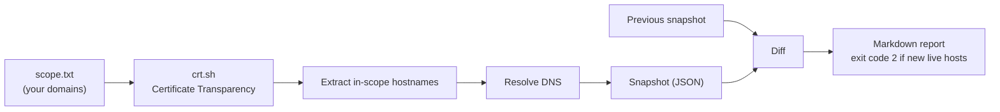

# Attack Surface Monitor

A lightweight, **passive** attack surface management (ASM) tool. It finds the hostnames of a domain
you own from public Certificate Transparency logs, resolves which ones are live, and on every run
reports what changed: new subdomains, newly live hosts, removed hosts and IP changes.

Forgotten staging servers and dev subdomains are a classic way organisations get breached. This tool
answers one ASM question continuously: *what do we have exposed today that we didn't have yesterday?*

> **Scope:** passive only (public CT logs + ordinary DNS lookups). No scanning, no probing.
> Only list domains you own or are authorised to monitor in `scope.txt`.

## How it works



## Usage

```bash
git clone https://github.com/Pzycokid/attack-surface-monitor.git
cd attack-surface-monitor
cp scope.example.txt scope.txt      # then put your own domain(s) in scope.txt
python3 -m asm.monitor --scope scope.txt --data data
```

The first run saves a baseline. Later runs write `data/<domain>-report.md` like this:

```
# Attack surface report: example.com
- Hostnames seen in CT logs: **14**
- Currently resolving (live): **9**

## New hostnames that are live (review first) (1)
- `staging.example.com`

## IP address changes (1)
- `www.example.com`: ['203.0.113.10'] → ['203.0.113.42']
```

The process exits with code **2** when new live hosts appear, so a cron job or CI pipeline can
alert on it.

## Run it on a schedule

[`.github/workflows/monitor.yml`](.github/workflows/monitor.yml) runs the monitor daily with
GitHub Actions. Set a repository variable `ASM_SCOPE` containing your domains (one per line) to
enable it; the job is skipped otherwise.

## Tests

```bash
pip install -r requirements.txt
python3 -m pytest -q
```

## Roadmap

- [x] CT-log discovery, DNS resolution, snapshot diffing, Markdown report
- [x] Scheduled GitHub Actions run
- [ ] Flag hostnames whose names suggest non-production (dev, test, staging, old)
- [ ] TLS certificate expiry check for live hosts
- [ ] Send new-host alerts to [BlueShield](https://github.com/Pzycokid/blueshield)

## Author

**Likhith H S**, M.Sc. Cyber Security, NFSU Goa · CEH · CCNA ·
[LinkedIn](https://www.linkedin.com/in/LikhithHS15)
